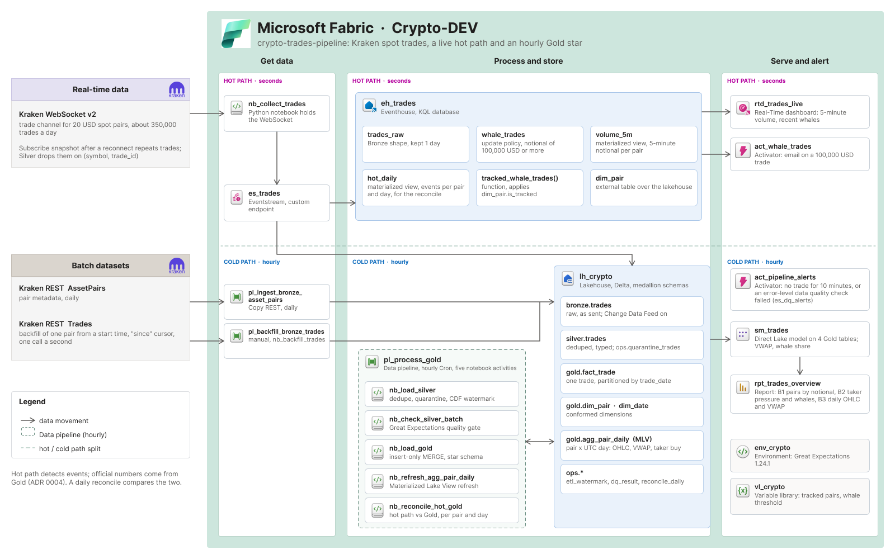
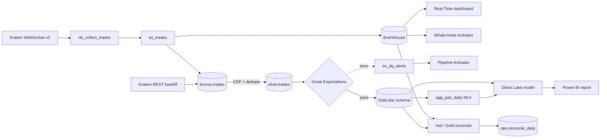
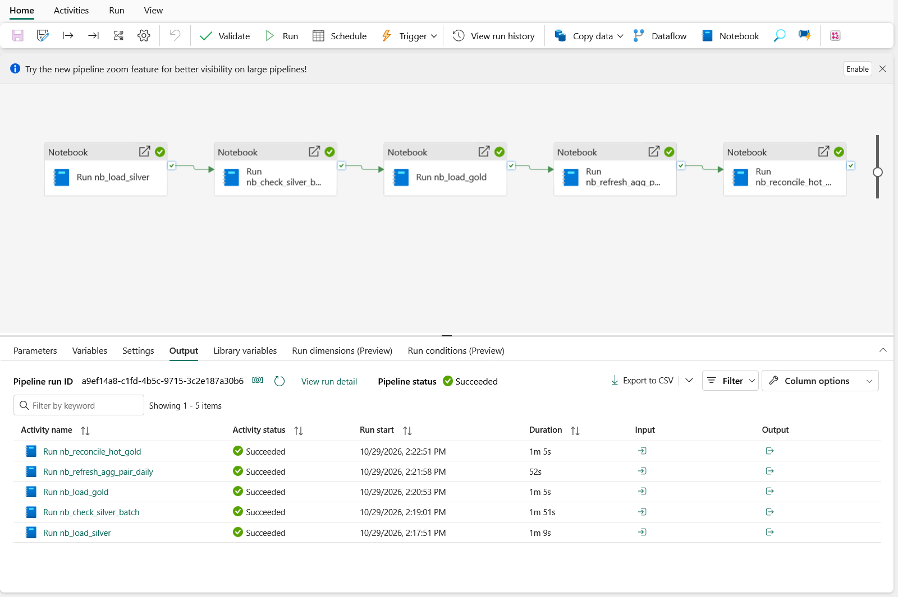
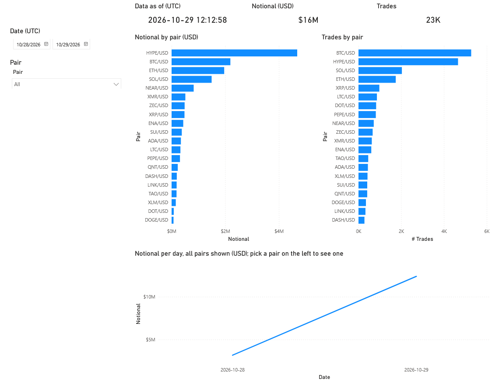
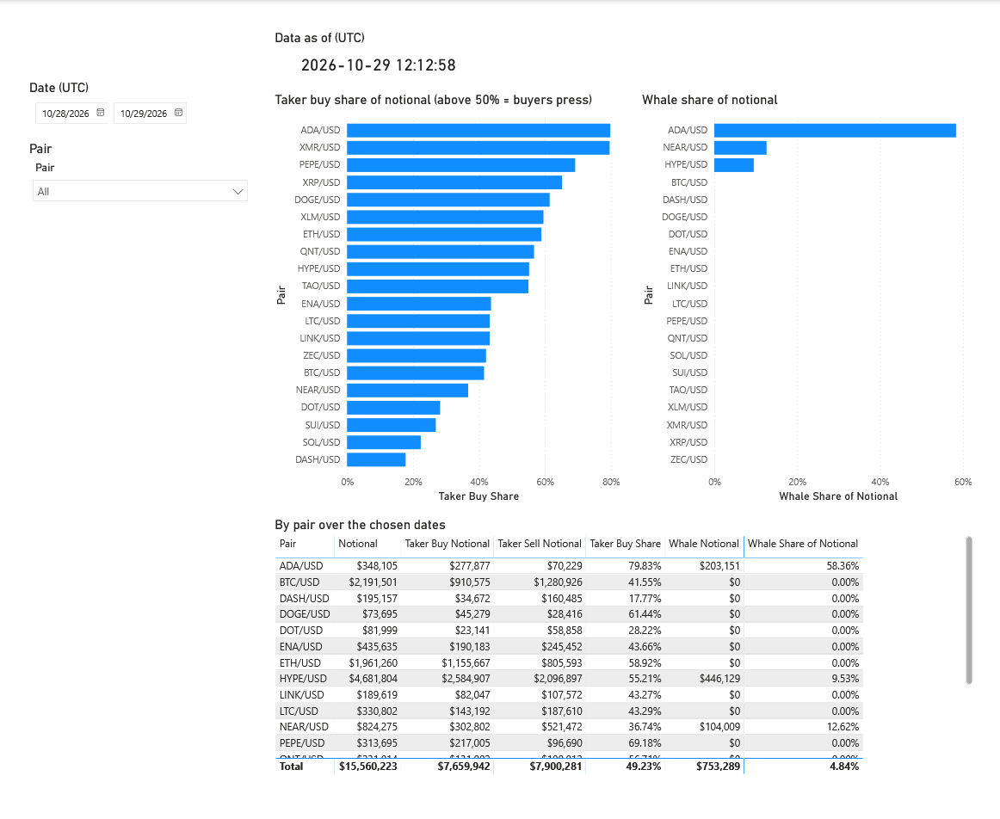
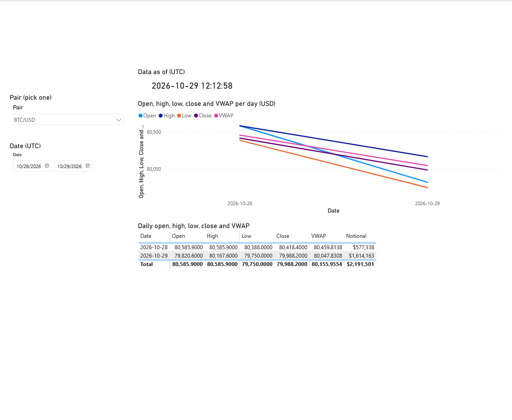
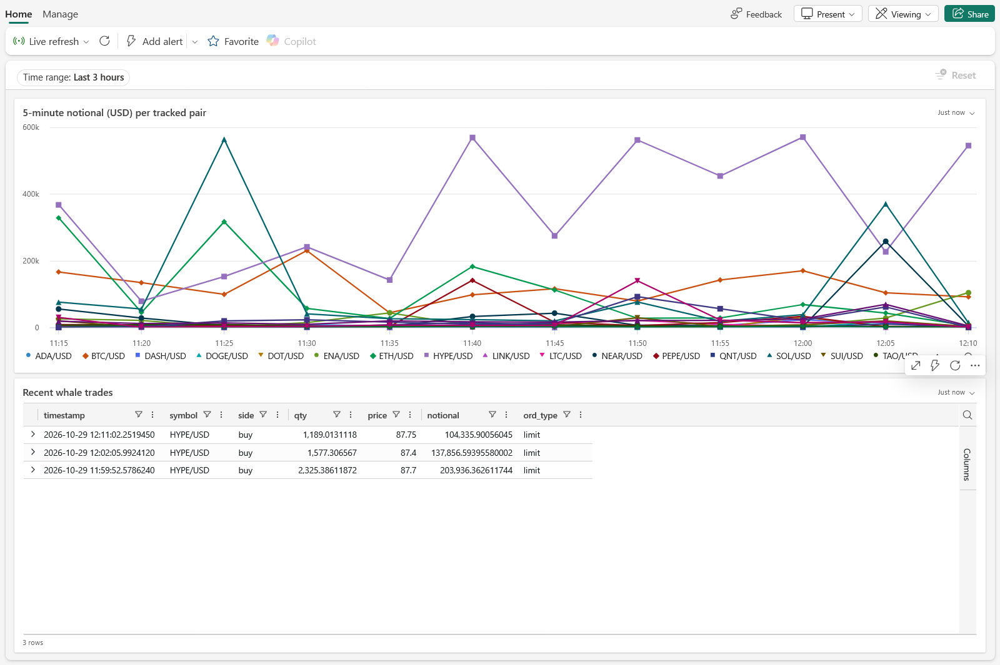

# Crypto Trades Pipeline

Microsoft Fabric • Eventstream • Eventhouse (KQL) • Delta Lake • PySpark • Great Expectations • Power BI

An end-to-end data pipeline that turns Kraken spot trades into live whale-trade detection and hourly trading analytics for 20 USD pairs. A hot path feeds a Real-Time dashboard; a cold path builds a quality-gated Gold star schema for pair rankings, taker pressure, and daily OHLC and VWAP.

> Portfolio project: built in a single Fabric DEV workspace to demonstrate streaming ingestion, incremental Spark processing, data quality, and analytical modeling. Collector gaps are accepted and reported; Gold is the source of official metrics within the project.

| Coverage | Processing | Local tests | Benchmark |
|---|---|---|---|
| 20 USD spot pairs | Live hot path · hourly Gold | 24 unit tests | Up to 3.5 M rows per pipeline run (synthetic) |

## What it demonstrates

- **Two paths with clear responsibilities.** Eventhouse detects whale trades and charts 5-minute volume. Gold owns the analytical metrics; reconciliation records the differences between the paths.
- **Incremental loads by commit version.** Silver and Gold read Delta Change Data Feed (CDF), with separate cursors in `ops.etl_watermark`. Each cursor advances after its step writes successfully ([ADR 0002](reference/decisions/0002-commit-version-watermark.md)).
- **Idempotent processing.** Batch deduplication and insert-only `MERGE`s on (`symbol`, `trade_id`) prevent reconnect snapshots, retries, and REST backfills from counting a trade twice.
- **Quality gates before Gold.** Silver quarantines invalid rows. Great Expectations checks the Silver batch, blocks downstream Gold activities on error, and records results in `ops.dq_result`.
- **Analytical modeling.** A trade fact, two dimensions, and a daily Materialized Lake View feed a Direct Lake semantic model. DAX measures handle ratios, weighted VWAP, and OHLC roll-ups.
- **Recovery and verification.** Fabric tests exercise overlapping batches, backfills, forced failures, and reruns on scratch tables. Benchmarks measure pipeline time, file layout, compaction, and join strategies.

## Architecture



<details>
<summary>View the flow as Mermaid</summary>



</details>

| Layer | Technology | Responsibility |
|---|---|---|
| Source | Kraken WebSocket v2 + REST | Live trades, manual historical backfill, pair metadata |
| Ingestion | Python notebook + Eventstream | Normalize events and send the same stream to both paths |
| Hot path | Eventhouse, KQL, Activator | Whale trades (notional ≥ 100,000 USD), 5-minute volume, daily event totals |
| Bronze | Lakehouse Delta | Append raw trades with source field names and ingestion metadata |
| Silver | PySpark | Cast types, filter tracked pairs, deduplicate, quarantine invalid rows |
| Quality gate | Great Expectations | Validate the batch before Gold; record errors and warnings |
| Gold | PySpark + Materialized Lake View | Trade fact, dimensions, daily aggregate |
| Control | Delta `ops` tables | Watermarks, quarantine, quality results, reconciliation |
| Serving | Real-Time dashboard + Direct Lake / Power BI | Live event monitoring and hourly analytical reporting |

The aggregate uses CDF and a fact table partitioned by `trade_date`; the refresh notebook also requests a weekly full refresh. Fabric's refresh conditions are documented in [Microsoft Learn](https://learn.microsoft.com/fabric/data-engineering/materialized-lake-views/refresh-materialized-lake-view).

## Pipelines

The hourly `pl_process_gold` runs five notebook activities in order:

```text
Silver → quality gate → Gold → daily aggregate refresh → hot / Gold reconcile
```

| Item | Schedule | Unit of work |
|---|---|---|
| `nb_collect_trades` | Scheduled 55-minute sessions; paused outside demos | Hold the WebSocket subscription and forward trades |
| `pl_ingest_bronze_asset_pairs` | Daily, 00:15 UTC | Land an `AssetPairs` snapshot and update `gold.dim_pair` |
| `pl_process_gold` | Hourly | Process new commits, refresh the aggregate, reconcile yesterday and today |
| `pl_backfill_bronze_trades` | Manual | Append REST trades for one tracked pair and a UTC time range |

A backfill enters Bronze and follows the same Silver and Gold logic. It can add missing trades without changing the hot path's event history.



## Data model

| Gold model | Grain | Purpose |
|---|---|---|
| `fact_trade` | Pair × trade ID | Deduplicated trades, taker side, quantity, price, USD notional |
| `dim_pair` | Pair ever tracked | Base asset, quote asset, status, tracked flag |
| `dim_date` | UTC calendar day | Calendar attributes for filtering and grouping |
| `agg_pair_daily` | Pair × UTC day | OHLC, volume, notional, VWAP, trade count, taker-buy notional |

The fact and aggregate both reference the pair and date dimensions. Notional is `qty × price` in USD; volume is in base-asset units and is only additive within a pair. VWAP is `Σ notional / Σ volume`; OHLC and percentage measures are never summed.

Keys and roll-up rules: [Gold model](reference/architecture/gold-model.md). Business terms: [glossary](reference/glossary.md).

## Report

Three Power BI pages answer the batch questions; each shows a **Data as of (UTC)** card based on the newest Gold trade. The separate Real-Time dashboard shows incoming events.

| B1 · Which pairs draw the most notional? | B2 · Taker pressure and whale share |
|---|---|
|  |  |
| **B3 · Daily OHLC and VWAP** | **Live · 5-minute volume and whale trades** |
|  |  |

## Data quality and testing

| Check | Behavior |
|---|---|
| Silver row rules | Invalid keys, quantities, prices, sides, order types, or timestamps go to `ops.quarantine_trades` with a rule ID |
| Schema, key uniqueness, pair reference integrity | Error: stop downstream Gold activities and send a DQ alert event |
| Batch volume, freshness, `trade_id` contiguity | Warning: record the result; backfills and collector pauses can legitimately break these baselines |
| Hot / Gold reconciliation | Compare counts and notional per pair and UTC day; split the gap into duplicates, late/rejected data, backfill, and unexplained delivery differences |

**Local:** 24 unit tests cover pure-Python pair mapping, REST conversion, and pagination. No Fabric connection is needed:

```sh
python -m unittest discover tests
```

**Fabric:** `nb_test_*` notebooks test Silver, Gold, the quality gate, backfill, reconciliation, aggregate refresh, and semantic-model measures. `nb_test_process_gold` runs the real pipeline through the job API on scratch tables, including forced failure and recovery. Spark tests require Fabric; the DAX tests query the deployed model.

Test, spike, and benchmark definitions remain in the repo after removal from the workspace to keep its lineage view readable. Their recorded results are under `lh_crypto/Files/checks/`; importing a definition restores the notebook, not its deleted run history.

## Measured run

Recorded on **29 October 2026** in `Crypto-DEV`. Live measurements cover one 60-minute collector session (16,748 events) plus development runs. Scale tests use **synthetic** rows generated from the live Bronze shape; they are not sustained production traffic.

| Measurement | Recorded result | Basis |
|---|---|---|
| Stored rows | Bronze 23,017 · Silver 22,957 · Gold fact 22,957 | Table counts including development runs |
| Trade → Eventhouse latency | P50 0.7 s · P95 1.6 s · P99 13.4 s | 15,758 live trades |
| Trade → Bronze file latency | P50 62 s · P95 117 s | Same live sample; Gold follows the hourly schedule |
| Pipeline time | 17,000 rows: 390 s · 350,000: 386 s · 3.5 M: 436 s | One synthetic run per size; counts and notional matched through Gold |
| Idempotency at scale | Rerun left Silver, Gold, aggregate, and watermarks unchanged | 3.5 M synthetic rows, no new input |
| Scheduled reliability | 15 / 16 runs succeeded (93.8%) | One-day window; one Spark capacity failure, followed by a successful scheduled run |
| Reconciliation | 18,657 hot events vs 18,653 Gold trades | Four whale-alert test events account for the 800,000 USD gap |
| Storage layout benchmark | 9.8 M rows, 354 MB in the flat layout | Synthetic 28-day Bronze copy |

At this volume, a single machine would be sufficient. Spark is used to demonstrate incremental processing and Fabric integration; much of the measured pipeline time comes from starting five Spark sessions. The [benchmark](docs/bronze-benchmark.md) explains the method, file-layout trade-offs, and Spark-versus-DuckDB discussion. The [reconciliation walkthrough](docs/reconcile-hot-vs-gold.md) traces a real gap, including one event whose delivery difference remained unexplained.

## Reproducing the project

This is a Fabric workspace export with manual setup and rebinding. Local tests run independently; the full pipeline requires a Fabric capacity and a `Crypto-DEV` workspace.

1. Clone the repository and run the local tests:

   ```sh
   git clone https://github.com/DKSang/crypto-trades-pipeline.git
   cd crypto-trades-pipeline
   python -m unittest discover tests
   ```

2. Install the [Fabric CLI](https://aka.ms/fabric-cli) and Azure CLI. For this repo's service-principal login, create a local, uncommitted `.env` with `client_id`, `ternan_id` (the script's existing spelling), and `sp_secret`. From a POSIX shell, run `sh scripts/fabric-login.sh`.
3. Follow the [environment inventory](reference/environment.md) and [CLI notes](reference/fabric-cli.md) to recreate dependencies and bind the exports. Replace original workspace, lakehouse, item, and connection IDs for your environment; configure valid alert recipients. Definitions are under `fabric/Crypto-DEV/`.
4. Set up `lh_crypto` and Bronze with `nb_setup_lakehouse`, wire the Eventstream destinations, and populate `gold.dim_pair` before the first Gold batch. Run the collector, then `pl_process_gold`; check quality results, reconciliation, and the report's data timestamp.

Import syntax for a notebook, once its dependencies and IDs are configured:

```sh
fab import "Crypto-DEV.Workspace/nb_load_silver.Notebook" -i fabric/Crypto-DEV/nb_load_silver.Notebook -f --format .py
```

## Repository structure

```text
fabric/Crypto-DEV/   # Exported definitions: 28 notebooks, 3 pipelines, streaming and serving items
reference/          # Architecture, Gold model, ADRs, glossary, environment, lessons
docs/               # Benchmark, reconciliation walkthrough, screenshots
scripts/            # Service-principal login and KQL runner
tests/              # Local pure-Python unit tests
data/               # Small development samples
```

## Documentation

- [Architecture and schedules](reference/architecture/trades-pipeline.md)
- [Gold model, keys, and double-counting rules](reference/architecture/gold-model.md)
- [Benchmark and Spark trade-offs](docs/bronze-benchmark.md)
- [Hot / Gold reconciliation](docs/reconcile-hot-vs-gold.md)
- Decisions: [commit-version watermarks](reference/decisions/0002-commit-version-watermark.md), [PySpark and MLV](reference/decisions/0003-pyspark-notebooks-and-mlv-no-dbt.md), [hot-path scope](reference/decisions/0004-hot-path-detects-events-only.md), [Kraken trade key](reference/decisions/0006-kraken-spot-trades-keyed-by-trade-id.md), [collector gaps](reference/decisions/0007-collector-holds-websocket-gaps-accepted.md)
- [Environment](reference/environment.md), [CLI operations](reference/fabric-cli.md), and [lessons learned](reference/lessons.md)

## Limitations

- **Incomplete live coverage.** Gaps between collector sessions are accepted. Missing trades stay absent from both paths until manually backfilled into Gold; reconciliation alone cannot detect trades neither path received.
- **Small measurement window.** One live hour and one day of scheduled-run history; scale benchmarks are synthetic and do not establish long-term reliability.
- **Whale email not delivered.** The DEV test triggered the alert, but the owner's external recipient addresses were rejected. Evidence is Activator's error email; `act_pipeline_alerts` also has a placeholder recipient. See [observed behavior](reference/lessons.md).
- **Warnings need follow-up.** Two `trade_id_contiguity` checks failed in the measured window and were not investigated. An empty Silver batch runs no gate checks, so the gate alone does not prove ingestion is healthy.
- **DEV deployment only.** No deployment stages or automated environment provisioning; exported IDs require rebinding. A quality-gate failure blocks Gold activities but does not provide an atomic publication snapshot across all Gold tables and serving items.
