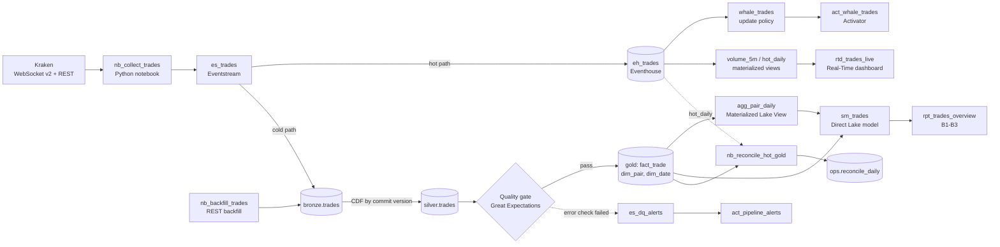

# crypto-trades-pipeline

An end-to-end data pipeline on **Microsoft Fabric** for Kraken spot trades: a live **hot path** that raises an alert and feeds a real-time dashboard within seconds, and a **cold path** that builds a tested, quality-gated **Gold star schema** every hour.

`Eventstream` · `Eventhouse (KQL)` · `Lakehouse (Delta)` · `PySpark notebooks` · `Materialized Lake Views` · `Data pipelines` · `Great Expectations` · `Activator` · `Direct Lake + Power BI`

Everything under `fabric/Crypto-DEV/` is the exported definition of the items in the Fabric workspace, so the repo is the source of truth for what runs. Built issue by issue (16 closed issues); each choice that is hard to reverse is a short decision record in [`reference/decisions/`](reference/decisions/).

## The problem

Trades on 20 USD pairs (about 350,000 a day) arrive as a stream. Two kinds of question need two kinds of answer:

| | Question | Where it is answered | Freshness |
|---|---|---|---|
| Hot | A whale trade (at least 100,000 USD) just happened. What is the 5-minute volume per pair? | Eventhouse, Real-Time dashboard, Activator | seconds |
| Gold | Which pairs draw money (B1)? Is taker buying or selling dominating, and how much is whales (B2)? Daily OHLC and VWAP per pair (B3)? | Lakehouse Gold star, Direct Lake model, report | hourly |

Official numbers come only from Gold; the hot path detects events and never defines a KPI ([ADR 0004](reference/decisions/0004-hot-path-detects-events-only.md)). A daily **reconcile** compares the two paths per pair and day and explains every gap.

## Architecture

The same flow as a Mermaid diagram

The cold path is one hourly data pipeline, `pl_process_gold`: Silver, quality gate, Gold, Materialized Lake View refresh, reconcile. Step by step with schedules: [`reference/architecture/trades-pipeline.md`](reference/architecture/trades-pipeline.md). Grain, keys and the double-counting rules of every Gold table: [`reference/architecture/gold-model.md`](reference/architecture/gold-model.md).

## Screenshots

| | |
|---|---|
| **B1** Which pairs draw the most | **B2** Taker pressure and whales |
|  |  |
| **B3** Daily OHLC and VWAP | **Live** Real-Time dashboard |
|  |  |

`pl_process_gold`, one hourly run: five notebook activities, all succeeded.

## Design decisions worth reading

| Decision | Why | Record |
|---|---|---|
| Incremental loads read Delta Change Data Feed by **commit version**, kept in a watermark table, not by timestamp | A rerun after a failure re-reads the same range; insert-only `MERGE`s make it harmless. Late data cannot slip behind a timestamp cursor | [ADR 0002](reference/decisions/0002-commit-version-watermark.md) |
| PySpark notebooks for Silver and Gold, Materialized Lake Views for the aggregate, no dbt | Dedupe, `MERGE` and quarantine written by hand to show the skills; the MLV refreshes incrementally | [ADR 0003](reference/decisions/0003-pyspark-notebooks-and-mlv-no-dbt.md) |
| Hot path only detects events; Gold owns every official number | Two sources of truth drift apart; the reconcile proves they have not | [ADR 0004](reference/decisions/0004-hot-path-detects-events-only.md) |
| Key is (`symbol`, `trade_id`) from Kraken, both for WebSocket and REST backfill | One trade has one key whichever path delivered it, so a backfill cannot double Gold | [ADR 0006](reference/decisions/0006-kraken-spot-trades-keyed-by-trade-id.md) |
| A Python-notebook collector holds the WebSocket; gaps between runs are accepted | Eventstream has no WebSocket source; the gap is measured by the quality gate rather than hidden | [ADR 0007](reference/decisions/0007-collector-holds-websocket-gaps-accepted.md) |
| Spark used although one node would do at this volume | Stated aim is Spark skills; the cost is measured and the DuckDB alternative is argued with public benchmarks | [`docs/bronze-benchmark.md`](docs/bronze-benchmark.md) |

## Data quality and testing

- **Silver** drops duplicates on (`symbol`, `trade_id`) and sends rows that break a rule to `ops.quarantine_trades` with one rule ID (`null_key`, `non_positive_qty`, `invalid_side`, ...).
- **Quality gate** (`nb_check_silver_batch`, Great Expectations on the Silver batch): schema, key uniqueness and reference integrity are *error* checks that stop Gold and alert; volume, freshness and `trade_id` contiguity are *warn* checks. Every result is stored in `ops.dq_result`.
- **Alerts**: no trade for 10 minutes, and an error-level check failed, both through Activator.
- **Spark logic is tested inside Fabric** on scratch tables in schema `test` (the test, check and benchmark notebooks live in `fabric/Crypto-DEV/` and were taken out of the workspace afterwards so its lineage view stays readable; `fab import` restores them): the 28 notebooks in the repo include `nb_test_*` suites for Silver (7 cases), Gold (8), the gate (9), the reconcile (9), the semantic model's measures (10), and `nb_test_process_gold`, which runs the real `pl_process_gold` through the job API (reruns, overlapping batches, duplicates, forced failure and recovery).
- **Pure-Python logic** is unit-tested locally: `python -m unittest discover tests` (24 tests).
- **Spikes before building** proved the risky assumptions first (WebSocket and REST agree, a notebook can hold the socket, CDF on an Eventstream-written table, Great Expectations on Spark). One partly failed and the design changed; see the end of [`trades-pipeline.md`](reference/architecture/trades-pipeline.md).

## Numbers

Taken on 2026-10-29 in `Crypto-DEV`. **Read** = counted from the real tables, **measured** = a run made for this purpose, **estimated** = worked out from other numbers, and the reasoning is given. The live data is one 60-minute collector session (16,748 events) on top of a day of development runs; the large volumes are synthetic rows in the Bronze shape (generated from the live pair mix, prices and quantities), and say so. How each was measured and the full tables: [`docs/bronze-benchmark.md`](docs/bronze-benchmark.md).

| Group | Metric | Value | |
|---|---|---|---|
| Data volume | Total records | Bronze 23,017 · Silver 22,957 · Gold `fact_trade` 22,957. Scale runs processed 3.5 M rows, layout benchmark 9.8 M (synthetic) | read, measured |
| | Data size | Bronze 2.0 MB in 158 files (90 B a row) · Silver 0.64 MB · Gold fact 0.75 MB (33 B a row). Synthetic 28-day copy: 354 MB | read, measured |
| | Daily ingestion volume | About 350,000 trades a day (4.4 live trades a second in the session, about 378,000 a day) ≈ 11 MB a day in Gold, 31 MB a day as Bronze lands it, ≈ 4 GB a year in Gold | estimated: Kraken 24 h count of 2026-10-28 and the session rate, times bytes a row above |
| Performance | Batch processing time | Pipeline for one hourly batch (17,000 rows): 390 s; one day (350,000): 386 s; ten days (3.5 M): 436 s. Real hourly runs with the session's batch: 381–400 s. Quality gate is the slowest step (99–140 s) | measured, one run per size |
| | Throughput | Whole pipeline 44 / 907 / 8,026 rows a second at 17,000 / 350,000 / 3.5 M, which mostly shows the fixed cost of five Spark sessions. Between the two largest batches: Silver about 167,000 rows a second, pipeline about 63,000 | measured |
| | P95 processing latency | Kraken trade to Eventhouse: **1.6 s** (median 0.7 s, P99 13.4 s). Kraken trade to a Bronze file: **117 s** (median 62 s, P99 122 s), landing alone is 62 s at the median, consistent with the Eventstream's roughly 2-minute commit. Gold follows on the next hourly run | measured, 15,758 live trades |
| Data quality | Data quality pass rate | 100% of the session's rows passed Silver's rules (0 of 16,748 quarantined). Gate: all error-level checks passed; of 12 results since the session start, 10 passed and the 2 failures are the warn-level `trade_id_contiguity` (not investigated) | read |
| | Duplicate records | 0 in the session (no key was already in Bronze). Whole Bronze: 54 duplicate rows, from development runs; Silver drops them | read |
| | Reconciliation accuracy | 2026-10-29: hot path 18,657 trades, Gold 18,653. The gap of 4 trades and 800,000 USD is the 4 test events of `nb_test_whale_alert`; without them both paths hold 18,653 trades and 12,384,735.43 USD (raw 99.98%, otherwise exact) | read |
| Reliability | Pipeline success rate | Scheduled runs 15 of 16 (93.8%), 2026-10-29 00:01 to 13:27. The one failure: a Spark capacity limit (HTTP 430) at `nb_check_silver_batch`, Gold's watermark held and the next run succeeded. Manual runs are left out (they include forced failures of the tests) | read |
| | Recovery time | After that failure, 62 minutes to the next green run, which is the hourly schedule. After a forced Gold failure and a rerun started at once: the failed run took 263 s and the green rerun **342 s** (`nb_test_process_gold` runs 3 and 4, a small fixture; a rerun on a bigger batch is about one pipeline run, 4–7 minutes) | read (62 min); measured (342 s, small batch); estimated (4–7 min for bigger batches) |
| | Idempotency validation | A rerun with nothing new left Silver, Gold, the aggregate and both watermarks unchanged, on 3.5 M rows. A batch overlapping earlier trades, a trade sent twice, a forced Gold failure and its rerun, a duplicate key written into Silver and its fix: `nb_test_process_gold`, 6 of 6 runs passed | measured (rerun at scale); test result (the rest, on a small fixture). A batch of 100% duplicates was not run at scale |

## What it shows about Spark

At this volume one machine is enough, and the pipeline's time is mostly the start of five Spark sessions: [`docs/bronze-benchmark.md`](docs/bronze-benchmark.md) has the layout, small-file and join measurements, published DuckDB-versus-Spark benchmarks, and why Spark is used anyway.

## Known limits

Stated plainly, because the numbers above are only as good as these caveats.

- **Small live sample.** One 60-minute collector session of real data; large volumes in the benchmarks are synthetic rows in the Bronze shape.
- **Whale email is not delivered.** Activator only mails addresses inside the tenant, and the owner's are outside it. The alert fires and Activator's error mail is the proof ([`reference/lessons.md`](reference/lessons.md)).
- **Gaps between collector runs are accepted** (ADR 0007): trades the collector misses are not in the hot path, and only a backfill adds them to Gold.
- **DEV only.** One workspace, no deployment stages, Fabric Git integration out of scope for now.
- **Warn-level `trade_id_contiguity` failed twice** in the measured window and was not investigated.

## Repository

| Path | Contents |
|---|---|
| `fabric/Crypto-DEV/` | Exported item definitions: 28 notebooks, 3 data pipelines, 2 Eventstreams, Eventhouse KQL schema, Real-Time dashboard, 2 Activators, Environment, Variable Library, semantic model (TMDL), report (PBIR) |
| `reference/` | Architecture, decisions (ADRs), glossary, naming conventions, lessons learned (every gotcha is labelled DOCUMENTED or OBSERVED with a date) |
| `docs/` | Bronze benchmark and the hot-path-vs-Gold reconcile write-ups |
| `scripts/` | `fabric-login.sh` (service principal sign-in), `kql-run.py` (apply KQL to the Eventhouse) |
| `tests/` | Local unit tests for pure-Python logic |
| `data/` | Small sample files for development |
| `AGENTS.md`, `CLAUDE.md` | Instructions for AI coding assistants used on this repo |

## Reproducing it

You need a Fabric capacity and a workspace named `Crypto-DEV`, the [Fabric CLI](https://aka.ms/fabric-cli) signed in (`sh scripts/fabric-login.sh` reads credentials from a local `.env`, not committed), and `python -m unittest discover tests` for the local tests. Items are published with `fab import "Crypto-DEV.Workspace/<item>.<Type>" -i fabric/Crypto-DEV/<item>.<Type> -f` (notebooks need `--format .py`). Order, IDs to fill in and gotchas: [`reference/fabric-cli.md`](reference/fabric-cli.md) and [`reference/environment.md`](reference/environment.md). Workspace and lakehouse IDs inside the definitions belong to the original workspace and must be replaced for another one. The recipient in `act_pipeline_alerts` is a placeholder.
